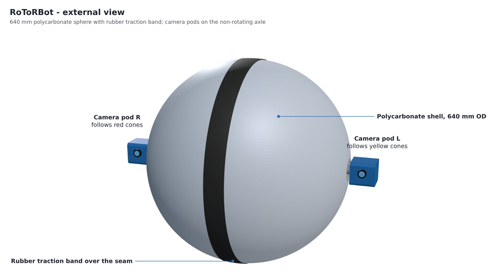
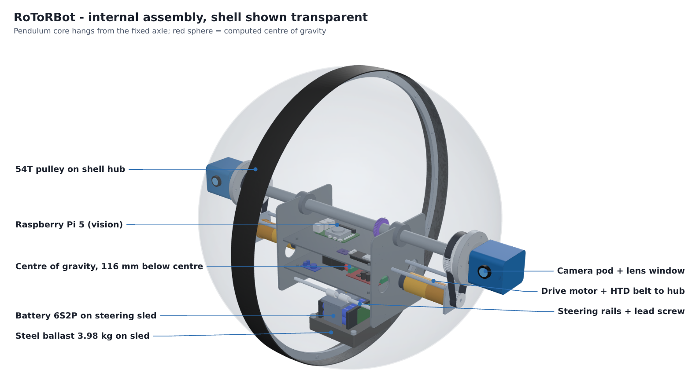
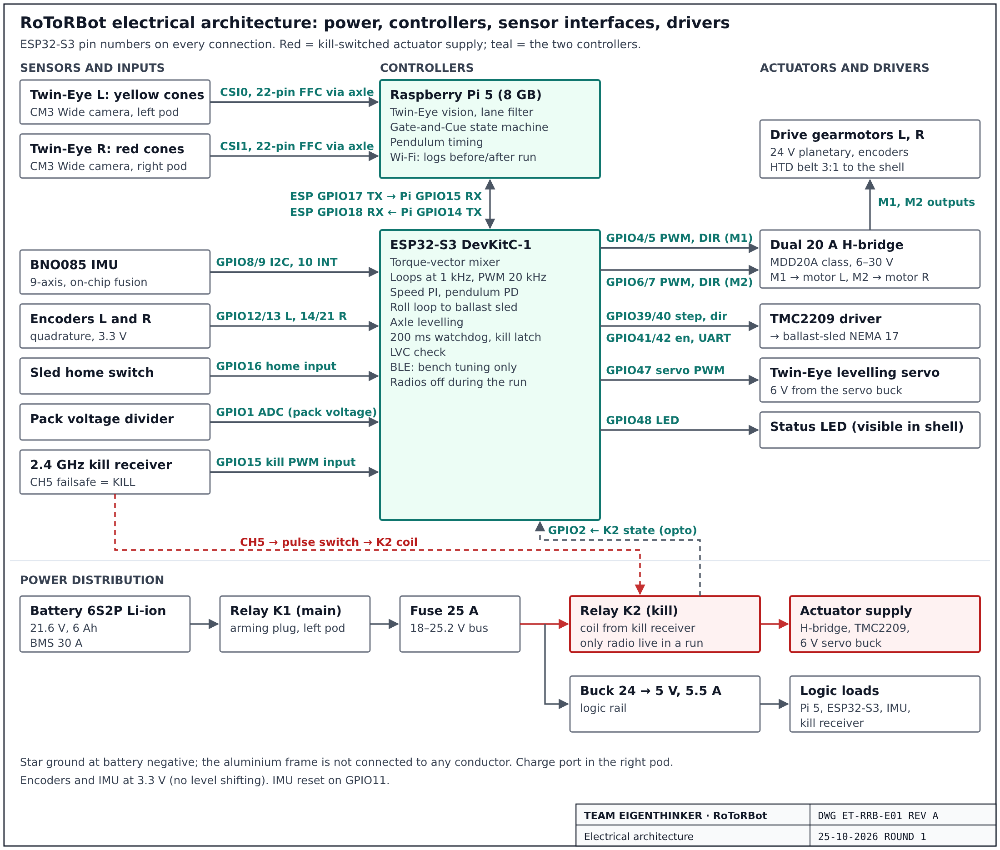
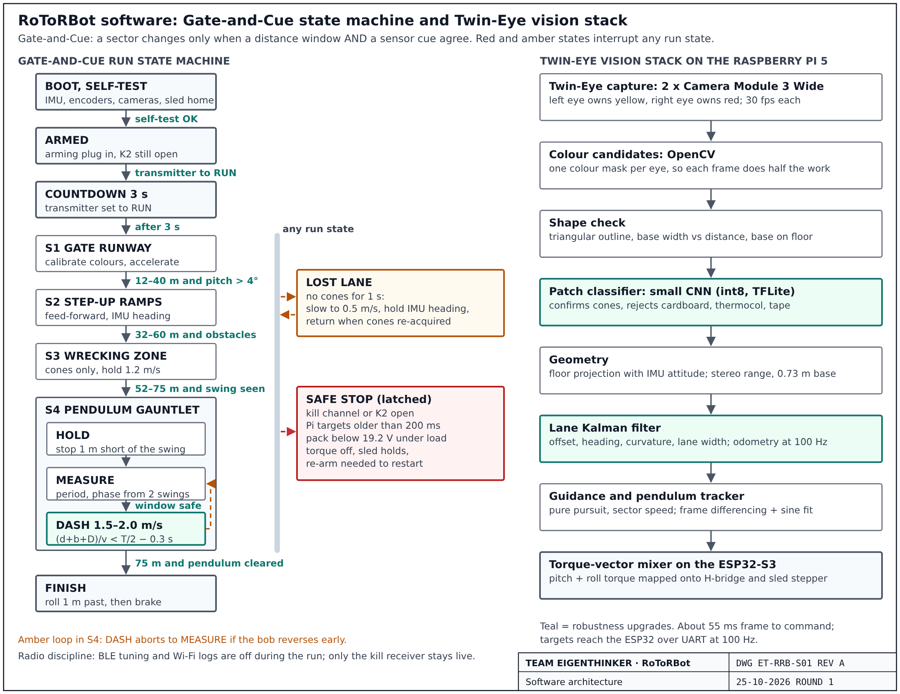
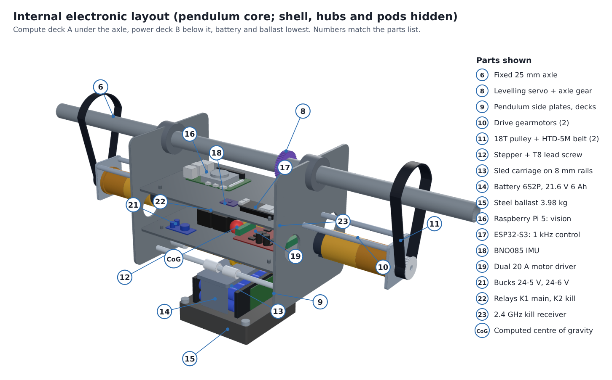
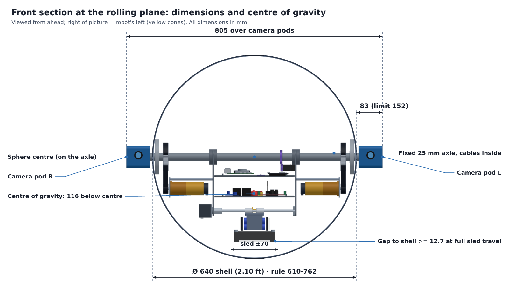
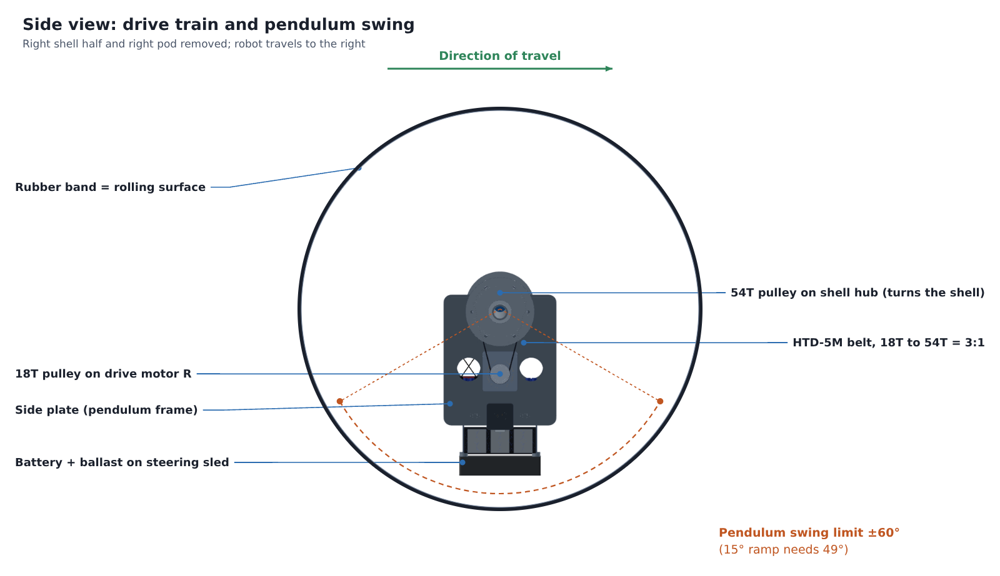

# RoToRBot

**An autonomous pendulum-driven sphere for the Wrecking Ball Challenge, Techfest 2026-27, IIT Bombay (Ultraviolette, PS 2).**
Team **EigenThinker** · Team ID `TM-CB1C8E0CEAA`

<p align="center">
  
  
</p>

A 640 mm polycarbonate ball rolls on a rubber traction band. Inside it, a pendulum core hangs from a fixed axle that never rotates. Two camera pods sit on the ends of that axle, outside the shell, and stay level while the ball rolls underneath them.

> **Status: design phase (Round 1).** Everything here comes from CAD and calculation. Parts have not been bought entirely yet. The STEP model, the scripts that produce every number, and the frozen pin map are the evidence for Round 1.

---

## Key numbers

| | |
|---|---|
| Outer diameter | 640 mm (2.10 ft); rule window 610 to 762 mm |
| Width over camera pods | 805 mm (pods protrude 83 mm, limit 152 mm) |
| Total mass | 14.0 kg |
| Centre of gravity | 116 mm below the sphere centre (X −0.2, Y −2.4, Z −116.2 mm) |
| Pendulum moment Σm·l | 1.625 kg·m |
| Steady climb limit | 18.3° at the 60° pendulum swing limit (course ramp 15°) |
| Shell torque | 12.0 N·m on 15°; 17.5 N·m design peak |
| Per motor | 3.1 N·m at 134 rpm, through HTD-5M 18T→54T belts (3:1) |
| Turning radius | about 1.5 m with the sled at ±70 mm |
| Pendulum rocking period | 1.6 s |
| Battery | Li-ion 6S2P, 21.6 V, 6 Ah, 30 A BMS, 25 A fuse |

Every value is computed by [`design/layout.py`](design/layout.py) and stored in [`design/numbers.json`](design/numbers.json). The item-by-item mass budget is in [`docs/mass_budget.csv`](docs/mass_budget.csv).

## What makes this design ours

1. **Twin-Eye axle.** Two cameras on the non-rotating axle, 0.73 m apart. The left one follows the yellow cones and the right one follows the red cones, and together they give stereo range to the pendulum obstacle. An internal servo keeps the axle level.
2. **Ballast-sled steering.** The battery and 3.98 kg of steel ride on one 4.91 kg sled that moves ±70 mm along the axle on a NEMA 17 and T8 lead screw. The mass that steers the robot is mass it already carries.
3. **Torque-vector control.** The controller sets a pitch-and-roll torque vector and maps it linearly onto the two drive motors and the sled stepper. We carried this approach over from our earlier spherical robot.
4. **Gate-and-Cue state machine.** The robot changes course sector only when two things agree: odometry says it is inside the expected distance window, and a sensor sees the matching cue. Neither one alone can move it to the wrong sector.
5. **Radio discipline.** BLE and Wi-Fi are on for bench tuning and switched off for the run. The only radio left on during a run is the independent 2.4 GHz kill link.

> [!IMPORTANT]
> **INNOVATION (future): Kandó-inspired adaptive capacitor network.** This is our long-term power goal. Kálmán Kandó's locomotives turned one fixed supply into whatever each motor needed. We want to do the same with a switched-capacitor array that an STM32 reconfigures in real time, and that can also use salvaged low-grade cells. It is a bench prototype for later phases. The competition robot runs on the baseline system above. See figure 08 and section 2 of the submission.

## Architecture

| Electrical (drawing ET-RRB-E01) | Software (drawing ET-RRB-S01) |
|---|---|
|  |  |

* **Raspberry Pi 5:** Twin-Eye vision (HSV, shape check, int8 CNN patch classifier), lane Kalman filter, Gate-and-Cue state machine, pendulum timing.
* **ESP32-S3:** 1 kHz speed PI loop, pendulum PD loop, roll loop to the sled, axle levelling, 200 ms watchdog. Pin map: [`firmware/esp32s3/include/pins.h`](firmware/esp32s3/include/pins.h).
* **Safety:** The K1 main relay is enabled by an arming plug in the left pod. The K2 kill relay is driven by a separate 2.4 GHz receiver, in hardware, without passing through either computer. Low-voltage cut-off warns at 19.8 V and stops at 19.2 V.

<p align="center">
  
</p>

## Repository layout

```
RoToRBot/
├── cad/
│   ├── RoToRBot_assembly.step            full assembly, 83 named, coloured parts (mm)
│   ├── RoToRBot_assembly.stl             same model as one mesh, opens in GitHub's 3D viewer
│   └── RoToRBot_internals_no_shell.stl   pendulum core, axle and pods without the shell
├── design/
│   ├── layout.py          masses, positions, CoG, slope, torque, turning radius (single source of truth)
│   ├── cad_detail.py      builds the STEP and STL files from layout.py (CadQuery)
│   ├── numbers.json       every computed value used in the submission
│   └── requirements.txt
├── docs/
│   ├── RoToRBot_Round1_Submission.pdf               official Round 1 template, filled
│   ├── RoToRBot_Phase1_CAD_and_System_Document.pdf  full calculations, BOM, risks (20 pages)
│   ├── mass_budget.csv
│   └── figures/           renders, sections and architecture drawings
├── firmware/
│   ├── README.md
│   └── esp32s3/include/pins.h
├── LICENSE
└── README.md
```

## Viewing the CAD

* **In the browser:** open [`cad/RoToRBot_assembly.stl`](cad/RoToRBot_assembly.stl). GitHub shows it in an interactive 3D viewer.
* **Full model:** download [`cad/RoToRBot_assembly.step`](cad/RoToRBot_assembly.step). It opens in SolidWorks, Fusion 360, Onshape, FreeCAD and other CAD tools, with every part named and coloured.

| Front section with dimensions | Side view of the drive train |
|---|---|
|  |  |

## Reproducing the numbers and the model

```bash
cd design
python layout.py                  # standard library only; prints every number and writes numbers.json
pip install -r requirements.txt   # CadQuery
python cad_detail.py              # writes build/RoToRBot_assembly.step and build/stl/*.stl
```

Change a mass or a position in `layout.py` and run both scripts again. The centre of gravity, the slope limit, the torque figures and the CAD all update together.

## Roadmap

- [x] Round 1: CAD abstract, full assembly, mass budget and CoG, power, control and autonomy architecture
- [x] Pin map frozen (ET-RRB-E01)
- [ ] Buy complete components ( current : extraction from old electronics ), sled and electronics; bench-test the kill chain (K1/K2) first
- [ ] ESP32-S3 control firmware: 1 kHz loops, torque-vector mixer, watchdog
- [ ] Pi 5 vision: cone detection, lane filter, Gate-and-Cue, pendulum dash timing
- [ ] Ramp and pendulum trials on a mock course
- [ ] Kandó-inspired capacitor network bench prototype (separate from the competition robot)


